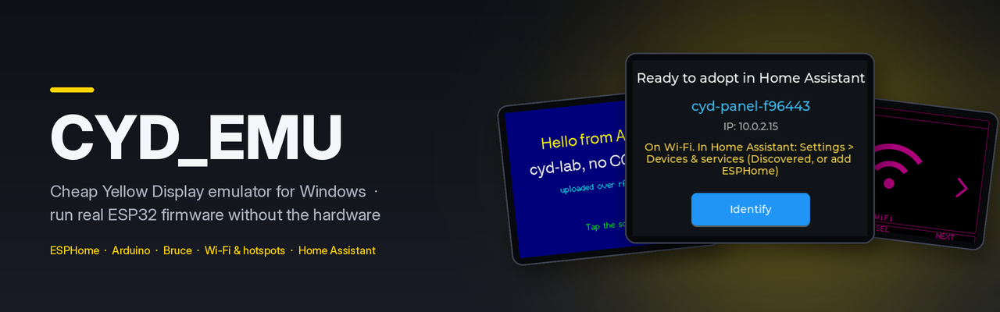
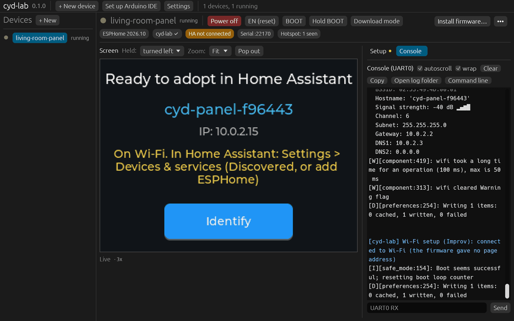
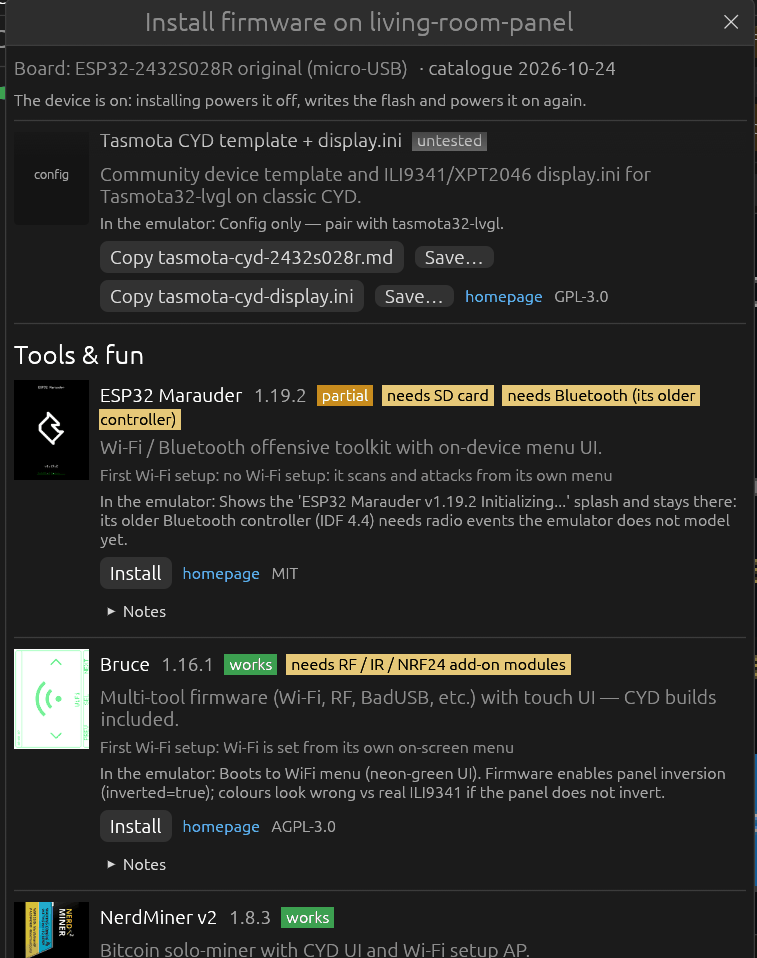
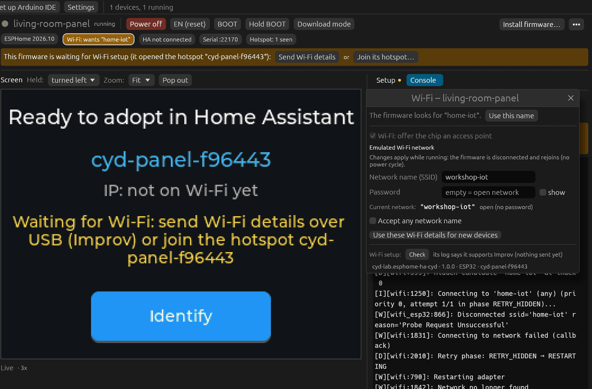
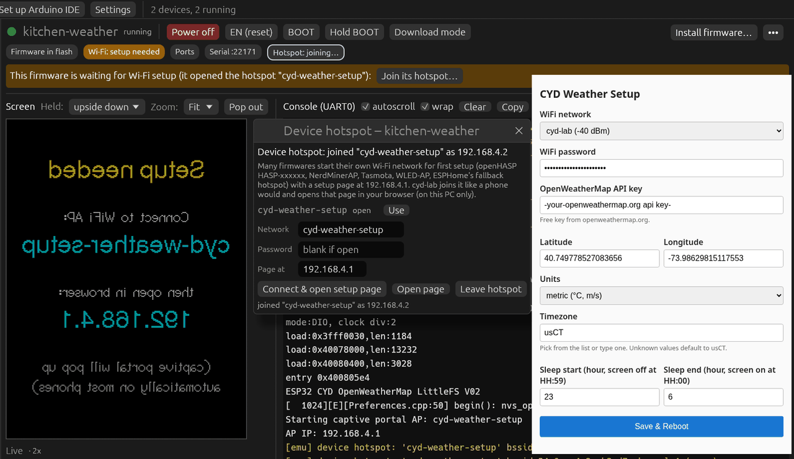
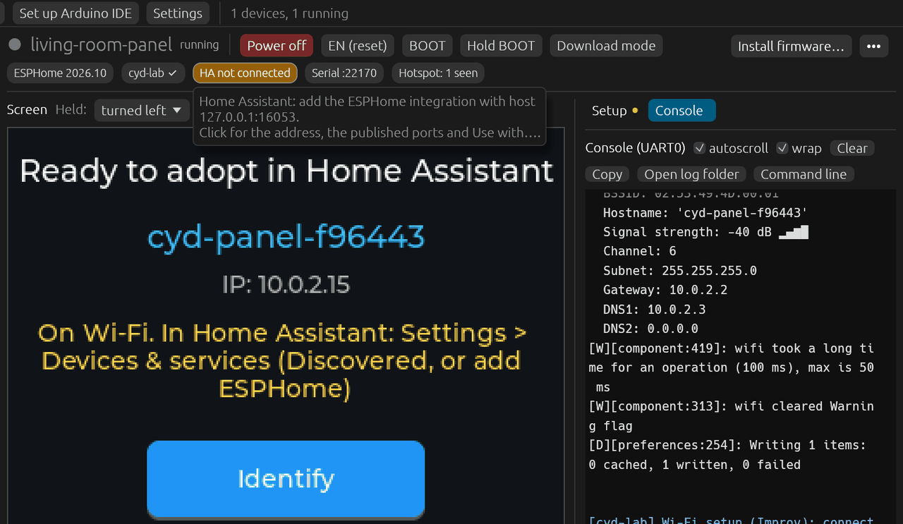
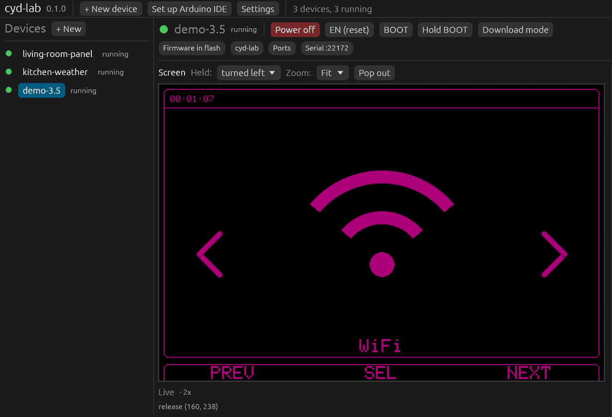
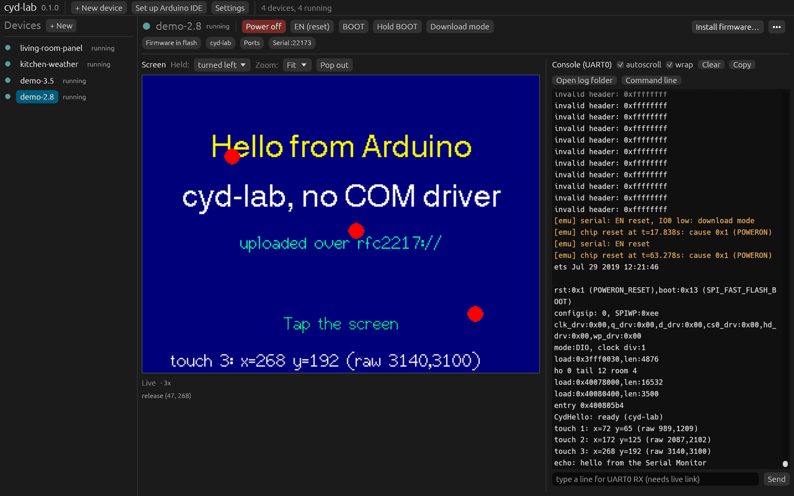

<p align="center">
  <picture>
    <source media="(prefers-color-scheme: light)" srcset="docs/readme/banner-light.png">
    
  </picture>
</p>

# CYD_EMU

> **This repository is a fork of [esp32sim](https://github.com/mikroverk/esp32sim)**, the ESP32
> emulator in Rust by Joakim Eriksson, Alice and Mattia Fiumara and its contributors. All the
> credit for the emulator itself goes to them. esp32sim's own README is kept, unchanged, below the
> divider further down this page.

The fork has a slightly different purpose from upstream. It turns esp32sim into a **Windows
desktop emulator for Cheap Yellow Display boards** (Sunton ESP32-2432S028R and its relatives), so
you can run and test real, unmodified firmware such as ESPHome, Arduino sketches, Bruce, openHASP
or NerdMiner without the hardware. Everything happens over local network ports on 127.0.0.1:
serial, flashing, Wi-Fi and Home Assistant. There's no USB or COM-port driver to install.

## What the fork adds to esp32sim

- **CYD board profiles**: the ESP32-2432S028R (original micro-USB and two-USB versions),
  2432S024R/C, 2432S032R/C and 3248S035R/C, with their ILI9341, ST7789 or ST7796 panels and
  backlight pins.
- **Touch panels**: the XPT2046 resistive controller, plus the CST816S and GT911 capacitive ones.
- **Live Wi-Fi**: change the emulated access point's name, password or "accept any network" while
  the firmware runs. The station is disconnected and rejoins, with no power cycle.
- **Device hotspots**: when the firmware opens its own access point (a setup portal, for
  example), the engine reports it, and a virtual phone can join it.
- **RFC 2217 serial**: UART0 on a TCP port, so esptool, PlatformIO, the Arduino IDE and ESPHome can
  flash and monitor it at `rfc2217://127.0.0.1:PORT`. The ROM download mode and autobaud work as
  they do on the chip.
- **Port forwarding**: `--hostfwd` publishes guest ports (the ESPHome API on 6053, OTA, web
  servers) on the PC, so Home Assistant can adopt an emulated device.
- **A persistent flash file**, so what the firmware writes survives a restart, plus the small
  engine fixes these boards needed.

## cyd-lab

[`cyd-lab/`](cyd-lab/) is the desktop app on top of the engine. It's a workbench of emulated CYDs,
each with its own flash, power switch, EN and BOOT buttons, serial console and touch screen. It
has a firmware gallery, Wi-Fi and Home Assistant setup, and an Arduino board package.

**Quick start on Windows**

1. Download `cyd-lab-windows-x64.zip` from the [Releases](../../releases) page.
2. Unzip it anywhere and run `cyd-lab\cyd-lab.exe`. There's no installer and no admin rights are
   needed. The exe isn't signed, so if SmartScreen asks, choose **More info > Run anyway**.
3. Click **+ New device**, pick ESP32-2432S028R, then **Power on** and **Install firmware…**.

The full guide is [cyd-lab/README.md](cyd-lab/README.md).

## See it in action

All of these are real captures of cyd-lab running unmodified firmware, on 127.0.0.1 only.

<table>
<tr>
<td width="50%" valign="top">

<br><sub><b>The workbench.</b> An ESPHome device on its emulated CYD, with its power, EN and BOOT buttons, touch screen and live serial console.</sub>
</td>
<td width="50%" valign="top">

<br><sub><b>Firmware gallery.</b> One click installs ESPHome, Bruce, NerdMiner, Marauder and more, each with notes on what works in the emulator.</sub>
</td>
</tr>
<tr>
<td width="50%" valign="top">

<br><sub><b>Live Wi-Fi.</b> Rename the emulated access point while the firmware runs; here ESPHome notices it's gone and falls back to its own hotspot.</sub>
</td>
<td width="50%" valign="top">

<br><sub><b>Device hotspots.</b> A weather station opens its setup access point; cyd-lab joins it like a phone and opens the captive portal in your browser.</sub>
</td>
</tr>
<tr>
<td width="50%" valign="top">

<br><sub><b>Home Assistant.</b> The ESPHome API is forwarded to a port on the PC, so Home Assistant can adopt the emulated device.</sub>
</td>
<td width="50%" valign="top">

<br><sub><b>Other boards.</b> Bruce on the 3.5" ESP32-3248S035C, with its ST7796 panel and GT911 capacitive touch.</sub>
</td>
</tr>
<tr>
<td colspan="2" valign="top">

<br><sub><b>Arduino and serial.</b> A sketch flashed by esptool over <code>rfc2217://127.0.0.1</code>, printing taps and echoing what you type in the serial console.</sub>
</td>
</tr>
</table>

## Repository layout, releases and licences

- **Layout**: the repository root is the esp32sim fork, a Cargo workspace (`cli/` is the
  `esp32sim` program, plus the chip, peripheral and CPU crates, `docs/` and `tools/`), with its
  full upstream history. `cyd-lab/` is cyd-lab, its own Cargo workspace, with its own history.
  Build the engine with `cargo build --release -p esp32sim`, and cyd-lab with `cargo run --release`
  in `cyd-lab/`.
- **Releases**: GitHub Actions (`.github/workflows/release.yml`) builds the Windows zip when a
  `v*` tag is pushed and attaches it to that tag's release. CYD_EMU's releases start at v1.0.0;
  esp32sim's own v0.x tags belong to upstream.
- **Licences**: esp32sim is MIT ([LICENSE](LICENSE)) and cyd-lab is MIT
  ([cyd-lab/LICENSE](cyd-lab/LICENSE), Gareth Johnstone). The two bundled ESPHome example images
  are GPL-3.0 binaries. That licence covers those images only. See [NOTICE](NOTICE) for these and
  the other third-party licences.

This fork is maintained separately by Gareth Johnstone. It isn't intended to be merged upstream,
and it isn't affiliated with or endorsed by the esp32sim authors, Espressif Systems or Sunton.

---

## Original esp32sim README

*Everything below this line is esp32sim's README as published upstream, unchanged.*

---

<p align="center">
  
</p>

# esp32sim

esp32sim is an ESP32 emulator written in Rust. It runs real ESP32 firmware on your computer or in
a browser tab, without the hardware.

It boots the chip's own mask ROM, the real second-stage bootloader and your unmodified application.
It also models the board around the chip: displays, touch, LEDs, buttons, audio, camera and WiFi.

Try it in your browser, nothing to install: https://mikroverk.github.io/esp32sim/

## Supported chips

| Chip | CPU | Status | Boards |
| --- | --- | --- | --- |
| ESP32-S3 | 2 x Xtensa LX7 | mature | Atech 14-port kit, Waveshare Touch-LCD-4B, Touch-AMOLED-1.8, ESP32-S3-CAM |
| ESP32-C3 | RISC-V RV32IMC | draft | console only |
| ESP32-C6 | RISC-V RV32IMAC | draft | Waveshare ESP32-C6-LCD-1.47, with the 802.15.4 radio |
| ESP32 (classic) | 2 x Xtensa LX6 | early | LilyGO TTGO T-Display |

## Features

- The full boot chain: mask ROM, bootloader, FreeRTOS, then your app. No patched firmware.
- WiFi with the unmodified Espressif WiFi library. Firmware joins a virtual access point, gets
  DHCP, DNS and NTP, and can reach the real network, HTTPS included.
- Board models, so firmware can draw on a display, read touch, light LEDs and play sound.
- Speed: the S3 has a block cache and a JIT, and runs hello_world about 30 times faster than real
  time.
- A WebAssembly build of the same emulator for the browser.
- Comparisons with real chips: the S3 in JTAG lock-step, the C3 and C6 by console diff. See
  [hardware testing](docs/hardware-testing.md).

## Demos

These run on the [demo site](https://mikroverk.github.io/esp32sim/):

- Linux 6.11 on the ESP32-S3 ([svermigo/Linux-on-esp32-S3](https://github.com/svermigo/Linux-on-esp32-S3)), with a login shell.
- The Atech kit's Pocket Synth and its C64 SID jukebox ([atech-firmware](https://github.com/joakimeriksson/atech-firmware)).
- An LVGL touch panel at 480x480 with a SID player.
- [pocket-tank](https://github.com/mediacutlet/pocket-tank), where a small transformer model steers the fish.
- An 802.15.4 energy scanner, and two Contiki-NG motes running RPL/IPv6, on the ESP32-C6.
- MicroPython on a classic ESP32 T-Display.

You can also load your own firmware for any of the chips.

## Quick start

No Rust needed: the [releases](https://github.com/mikroverk/esp32sim/releases) carry prebuilt binaries
for macOS and Linux, and [docs/quick-start.md](docs/quick-start.md) takes your own build from the tarball
to a run in three steps. From a checkout:

```sh
cargo build --release
tools/fetch-demo-assets.sh --no-linux       # downloads the mask ROMs, which are not in the repo

FW=web/wasm/fw/public                       # demo firmware included in the repo
./target/release/esp32sim --boot rom --rom web/wasm/fw/esp32s3_rev0_rom.elf \
    --bootloader $FW/atech-bootloader.bin --ptable $FW/atech-ptable.bin --app $FW/atech-firmware.bin \
    --script $FW/atech-script1.txt --wav out.wav --tft-png tft.png --max-seconds 5
```

This boots the Atech synth firmware, plays a short script, and saves the audio to `out.wav` and
the display to `tft.png`. Use `esp32sim-c3`, `esp32sim-c6` or `--chip esp32` for the other chips.

[Getting started](docs/getting-started.md) covers the rest: your own ESP-IDF builds, each chip,
WiFi, scripts, the browser build and debugging.

## Documentation

- [Quick start](docs/quick-start.md): install the release, fetch the mask ROM, run your own build, read the result
- [Getting started](docs/getting-started.md): running firmware on each chip, WiFi, scripts, the browser build
- [CLI reference](docs/cli.md): every flag, environment variable and output file
- [Boards](docs/boards.md): what each board models, and how to add one
- [Architecture](docs/architecture.md): how the emulator is put together
- [Peripherals](docs/peripherals.md): which hardware blocks are modelled, and how completely
- [Hardware testing](docs/hardware-testing.md): how the emulator is compared with real chips
- [All documents](docs/README.md): chip notes, design decisions and plans

## Contributing

Bug fixes, peripherals, boards and new chips are welcome. [CONTRIBUTING.md](CONTRIBUTING.md) lists
what a pull request needs; these are the same checks CI runs. Security problems go through
[SECURITY.md](SECURITY.md), not the public issue tracker.

## Credits and license

esp32sim is released under the [MIT License](LICENSE).

Authors: Joakim Eriksson, RISE ([@joakimeriksson](https://github.com/joakimeriksson)),
Alice ([@aliceisjustplaying](https://github.com/aliceisjustplaying)) and
Mattia Fiumara, Schematik ([@mfiumara](https://github.com/mfiumara)), together with
[other contributors](https://github.com/mikroverk/esp32sim/graphs/contributors).

The emulator was written from the ESP-IDF register headers, the Xtensa core configuration that
ships with ESP-IDF, the RISC-V specification, the chips' technical reference manuals and observed
firmware behaviour. QEMU was consulted only to confirm instruction semantics; no code was copied.

esp32sim is unofficial and not affiliated with Espressif Systems.

Third-party code, data and demo files keep their own licenses:

- pocket-tank ([mediacutlet/pocket-tank](https://github.com/mediacutlet/pocket-tank), MIT). Its
  bootloader, partition table and app are in `web/wasm/fw/public/` with `pocket-tank-LICENSE.txt`;
  its model is downloaded.
- MicroPython ([micropython.org](https://micropython.org/download/ESP32_GENERIC/), MIT): the
  official ESP32_GENERIC v1.29.0 image used by the T-Display demo, downloaded by
  `tools/fetch-micropython.sh` and not in the repo. The demo's app and filesystem are in
  `examples/ttgo-tdisplay`, with Russ Hughes's st7789py driver and fonts (MIT); the notice is in
  `web/wasm/fw/public/tdisplay-NOTICE.txt`.
- Mask ROM ELFs ([espressif/esp-rom-elfs](https://github.com/espressif/esp-rom-elfs), Apache-2.0),
  downloaded, not in the repo.
- xterm.js ([xtermjs/xterm.js](https://github.com/xtermjs/xterm.js), MIT), downloaded, not in the repo.
- The Linux image ([svermigo/Linux-on-esp32-S3](https://github.com/svermigo/Linux-on-esp32-S3),
  GPL-3.0), downloaded, not in the repo.
- ESP-IDF ADC calibration data (Espressif, Apache-2.0): the curve-fitting coefficients and S3 ADC1
  calibration from #165, in `esp-periph/src/sar_adc.rs`; see `esp-periph/LICENSE-ADC`.
